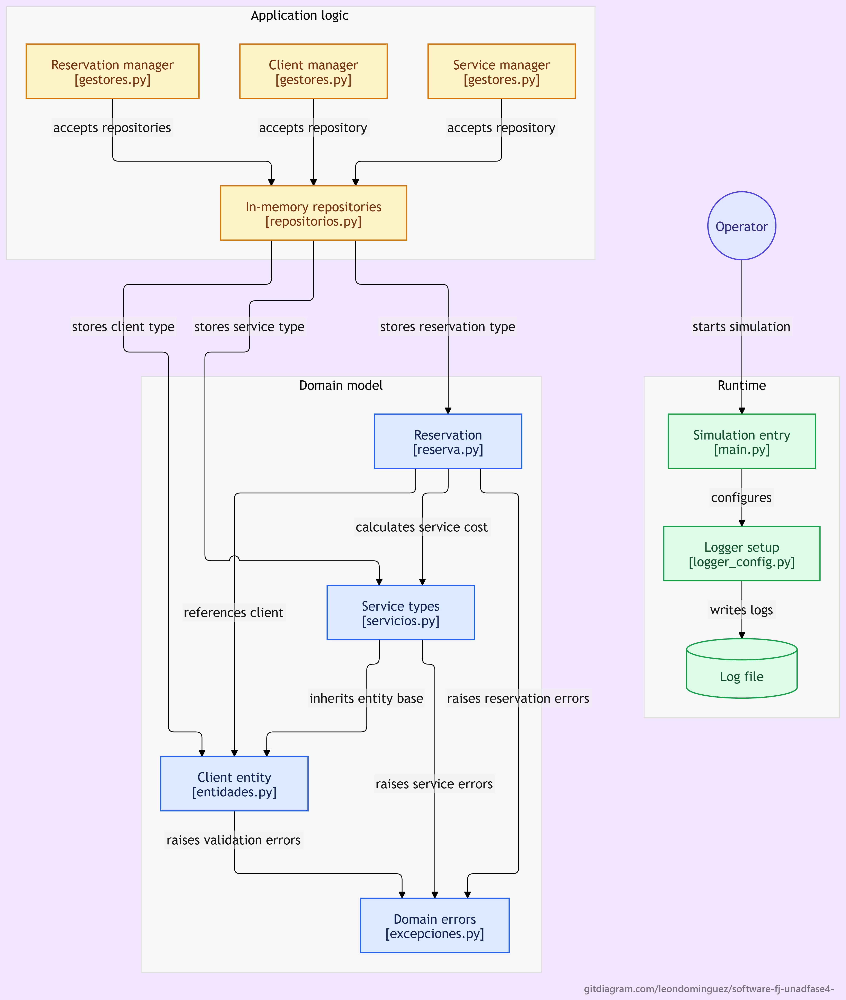

# Software FJ — Simulación de servicios y reservas

## Presentación

Software FJ es un programa de consola que simula la gestión de una empresa de servicios. Permite registrar clientes, ofrecer salas, alquilar equipos y brindar asesorías. También crea y cancela reservas, calcula sus costos y muestra mensajes cuando los datos no son válidos.

El proyecto está dividido en módulos para que cada parte tenga una responsabilidad clara. Los datos se guardan en memoria durante la ejecución; no se utiliza una base de datos.

## Integrantes

- León Domínguez
- Juan Camilo Bohórquez
- Erickson Castillo García
- Jhon Alex Jaramillo

## Diagrama del proyecto

El diagrama muestra cómo se conectan el inicio de la simulación, los gestores, los repositorios que mantienen los datos en memoria y las clases que representan clientes, servicios y reservas.



## Cómo ejecutar la simulación

Se necesita Python 3.9 o superior. No hace falta instalar paquetes adicionales.

Desde la carpeta del proyecto, ejecuta:

```powershell
py main.py
```

El programa presenta ejemplos de operaciones correctas y de errores controlados, como registrar datos inválidos o intentar una reserva con duración negativa. Al final muestra los clientes, servicios y reservas que quedaron registrados. Los mensajes de actividad también se guardan en `logs/software_fj.log`.

## Organización de los archivos

| Archivo | Para qué sirve |
|---|---|
| `main.py` | Inicia la simulación y presenta sus resultados. |
| `gestores.py` | Coordina el registro de clientes, la creación de servicios y las reservas. |
| `repositorios.py` | Guarda y busca clientes, servicios y reservas en memoria. |
| `entidades.py` | Define al cliente y valida sus datos. |
| `servicios.py` | Define las salas, los equipos y las asesorías, y calcula sus costos. |
| `reserva.py` | Confirma o cancela una reserva. |
| `excepciones.py` | Reúne los errores que el programa puede informar de forma controlada. |
| `logger_config.py` | Configura los mensajes que se muestran y se guardan en el archivo de registro. |

## Alcance

Este proyecto es una demostración académica ejecutada desde la consola. Los datos no se conservan al cerrar el programa y no incluye una interfaz gráfica ni una base de datos.

## Guía para trabajar con Git

Estos pasos sirven para practicar el trabajo con ramas y mantener los cambios organizados.

### 1. Clonar el proyecto

Este paso se hace una sola vez:

```bash
git clone https://github.com/leondominguez/software-fj-unadfase4-.git
cd software-fj-unadfase4-
```

### 2. Crear una rama para una tarea

Antes de comenzar, actualizar la rama principal y crear una rama propia. Cambia `feature/mi-tarea` por un nombre relacionado con tu trabajo:

```bash
git switch main
git pull origin main
git switch -c feature/mi-tarea  tambien es valido usar checkout
```

Si ya habías creado esa rama, vuelve a ella con `git switch feature/mi-tarea`; no es necesario crearla otra vez.

### 3. Traer cambios recientes de `main`

Repite estos pasos cuando quieras incorporar a tu rama los cambios más recientes de tus compañeros:

```bash
git fetch origin
git switch main
git pull origin main
git switch feature/mi-tarea
git merge main
```

`git fetch` consulta los cambios del repositorio remoto; `git pull` actualiza tu rama local `main`, y `git merge main` incorpora esos cambios a tu rama de trabajo.

### 4. Guardar y publicar tu trabajo

Revisa los archivos modificados, agrega solo los que quieras incluir y crea un commit:

```bash
git status
git add <archivo>
git commit -m "Describe brevemente el cambio"
git push -u origin feature/mi-tarea
```

En los siguientes envíos desde esa misma rama, puedes usar `git push`. Por ejemplo, para incluir el README y el diagrama, agrega `README.md` e `image/diagram.png` antes de crear el commit.
